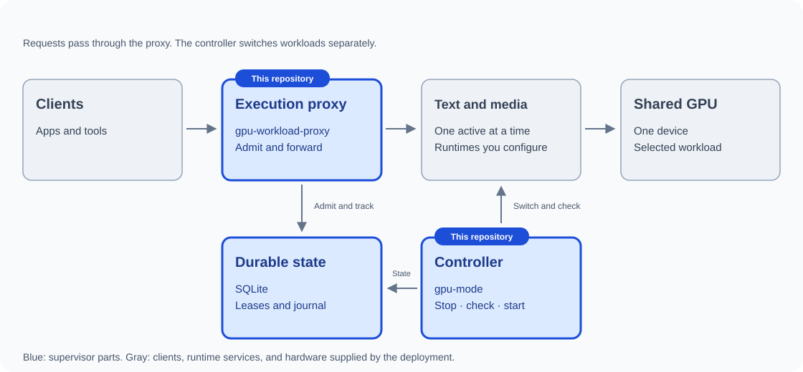

# GPU Workload Supervisor

Switches one GPU between configured workloads (ComfyUI, llama.cpp, Ollama, vLLM).
Stops and verifies the outgoing workload before starting the next; blocks requests
when a transition fails.

Binaries: `gpu-mode` (controller), `gpu-workload-proxy` (admission proxy),
`gpu-operator` (local operator backend), `gpu-setup` (detection and setup),
`gpu-training-runner` (experimental), `gpu-training-candidate` (unqualified input
preparation; not training execution).

<picture>
  <source media="(prefers-color-scheme: dark)" srcset="docs/architecture/generated/overview-dark.svg">
  
</picture>

- Controller: ownership and transitions.
- Proxy: admission and forwarding; no content policy.
- Brokers, gateways and scanners: external; not installed by setup.

[Architecture](docs/ARCHITECTURE.md).

## Requires

Linux with user systemd and cgroup v2.

## Install

Release archive or .deb from [Releases](https://github.com/mickey-kras/gpu-workload-supervisor/releases),
or `go build -o bin/ ./cmd/...`.

Setup detects and adopts supported systemd user services without rewriting their
source files. GPU correction: preview, then explicit Apply creates a drop-in for
an eligible stopped service. It does not start the service.

[Desktop setup](docs/DESKTOP.md).

## Setup checks

A path passes when it exists, is owned by you or root, and is not world-writable.
Group write is allowed only for groups you belong to; the single-admin host
policy trusts members of your own groups.
Symlinks and their traversed ancestors are checked; broken ones are reported by
name. Setup preserves supported direct commands and their arguments. It still
checks endpoint, model, GPU identity, environment and effective loaded settings;
shell commands, environment files and uninspected operational directives remain
unsupported. See [launch constraints](docs/WORKLOADS.md).

## Docs

- [Deploy and qualify a host](docs/DEPLOYMENT.md)
- [Switch workloads, recover](docs/OPERATIONS.md)
- [Back up and restore](docs/RESTORING.md)
- [All documentation](docs/README.md)

[MIT license](LICENSE).
